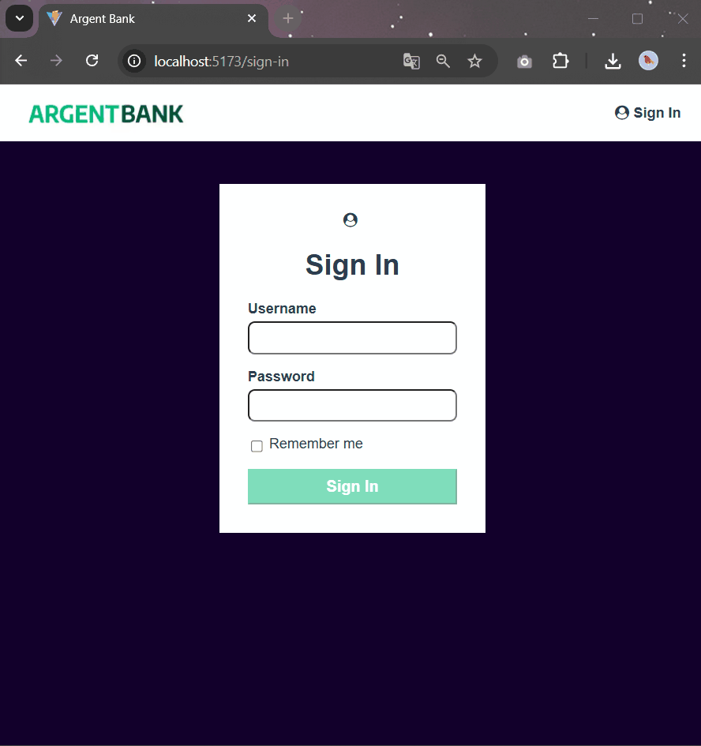
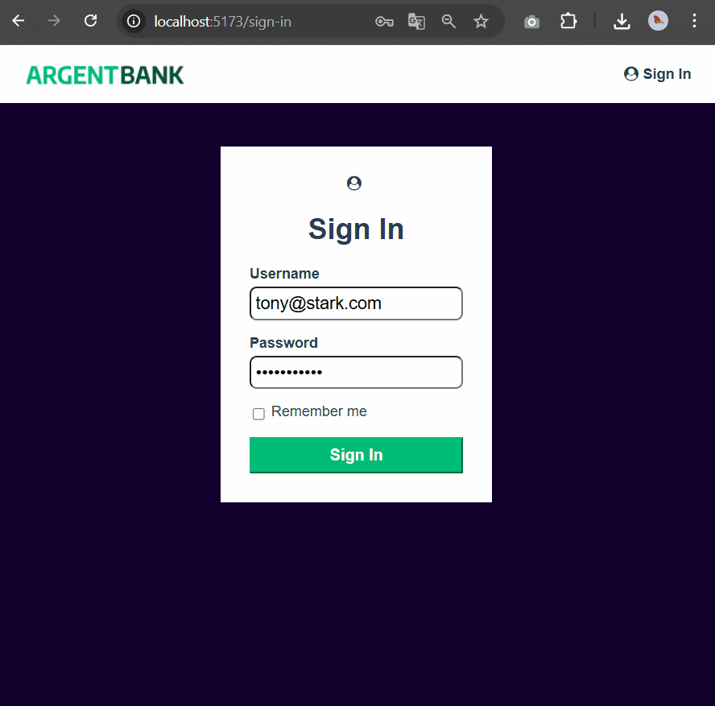
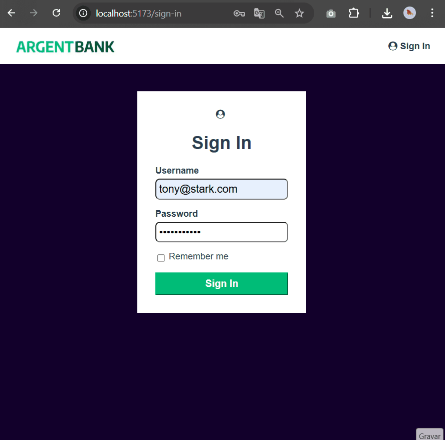
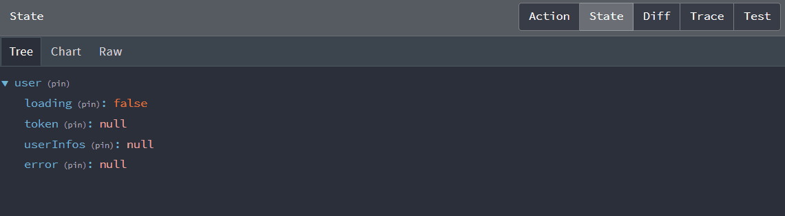

## À propos du projet

Ce projet a été réalisé dans le cadre de la formation Intégrateur Web d’OpenClassrooms, en respectant les exigences pédagogiques de la formation et en appliquant les bonnes pratiques du développement web.

Il s’agit d’une application bancaire développée avec React, utilisant un backend Node.js/Express. Redux Toolkit est utilisé pour la gestion de l’état global, notamment pour l’authentification des utilisateurs et la récupération des données de compte.

Le frontend est déployé sur Netlify à des fins de portfolio, tandis que le backend fonctionne localement afin de garantir une gestion sécurisée des données sensibles (les appels API sont effectués depuis le frontend vers le backend local).

## About the Project

This project was completed as part of the Web Integrator training program at OpenClassrooms, following the curriculum requirements and applying web development best practices.

It is a banking application built with React, using a Node.js / Express backend. Redux Toolkit is used for global state management, particularly for user authentication and account data retrieval.

The frontend is deployed on Netlify for portfolio purposes, while the backend runs locally to ensure secure handling of sensitive data (API calls are made from the frontend to the local backend).

## Démonstration de l’interface utilisateur :
## UI Demonstration:

**(FR) Parcours d’authentification**
**(EN) Authentication Flow**

  

🎥 Démonstration en GIF :
* Bouton « Sign In » désactivé lorsque les champs requis sont vides
* Message d’erreur pour email invalide
* Message d’erreur pour mot de passe incorrect
* Connexion réussie de l’utilisateur

🎥 GIF demonstration:
* Disabled “Sign In” button when required fields are empty
* Error message displayed for invalid email
* Error message displayed for incorrect password
* Successful user authentication

**(FR) Persistance de session – option « Remember me »**
**(EN) Session persistence – “Remember me” option**

  

🎥 Démonstration en GIF :
* Connexion de l’utilisateur **sans** l’option « Remember me »
* Actualisation de la page provoquant la déconnexion et le retour au formulaire
* Nouvelle connexion **avec** l’option « Remember me »
* Actualisation de la page conservant la session utilisateur active

🎥 GIF demonstration:
* User login **without** selecting the “Remember me” option
* Page refresh resulting in user logout and redirection to the login form
* New login **with** the “Remember me” option enabled
* Page refresh keeping the user authenticated

**(FR) Mise à jour du nom d’utilisateur et synchronisation de l’interface**
**(EN) Username update and UI synchronization**

  

🎥 Démonstration en GIF :
* Affichage du texte « Sign In » dans le header avant connexion
* Connexion de l’utilisateur et mise à jour du header avec le nom d’utilisateur et l’option « Logout »
* Affichage du nom d’utilisateur dans le message de bienvenue
* Ouverture du formulaire d’édition du nom d’utilisateur
* Annulation de l’édition et fermeture du formulaire
* Nouvelle ouverture du formulaire et modification du nom d’utilisateur
* Mise à jour automatique du nom d’utilisateur dans le header et le message de bienvenue sans rechargement de la page
* Déconnexion de l’utilisateur et retour à l’affichage du texte « Sign In » dans le header

🎥 GIF demonstration:
* Display of the “Sign In” text in the header before authentication
* User login updating the header with the username and “Logout” option
* Display of the username in the welcome message
* Opening the username edit form
* Cancelling the edit and closing the form
* Reopening the form and updating the username
* Automatic update of the username in both the header and welcome message without page reload
* User logout restoring the “Sign In” text in the header

## (FR) Gestion de l’authentification et du état global avec Redux DevTools :
## (EN) Authentication and global state management with Redux DevTools:

**(FR) Évolution de l’état Redux : état initial puis récupération des données utilisateur après authentification**
**(EN) Redux state evolution: initial state and user data retrieval after authentication**

  

**(FR) Gestion des erreurs d’authentification dans Redux : utilisateur invalide, mot de passe incorrect, puis connexion réussie**
**(EN) Redux authentication error handling: invalid user, incorrect password, then successful login**

  

**(FR) Gestion complète de la session : persistance avec « Remember me » après rechargement et retour à l’état initial après déconnexion**
**(EN) Complete session management: persistence with “Remember me” after page reload and return to initial state on logout**

  

